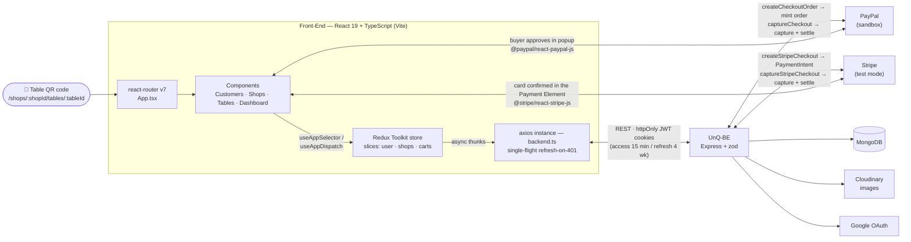
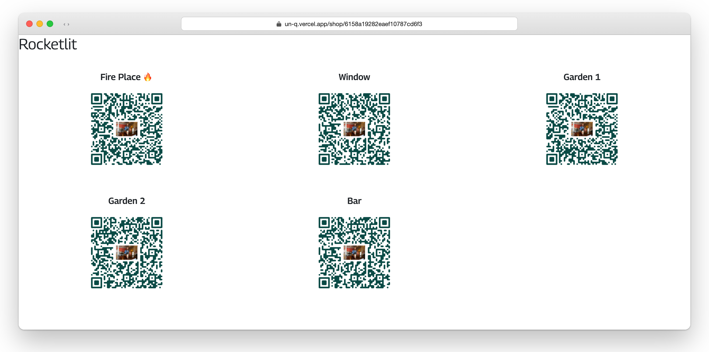

<div id="top"></div>

<!-- PROJECT LOGO -->
<br />
<div align="center">

<h3 align="center">UnQ — Front-End</h3>

  <p align="center">
    Scan a table's QR code, order into a shared cart, and pay for exactly the items you picked. The React client for the UnQ API.
    <br />
    React 19 · TypeScript 6 · Vite 8 · Redux Toolkit · Stripe Payment Element + PayPal · 428 tests
    <br />
    <br />
    <a href="https://github.com/Nando-C/UnQ-BE">Back-End repo</a>
    ·
    <a href="#try-customer-interface">View Demo</a>
    ·
    <a href="./CHANGELOG.md">Changelog</a>
  </p>

  <p align="center">
    <a href="https://github.com/Nando-C/UnQ-FE/actions/workflows/ci.yml"></a>
    
    
    
    
    
    
    
    
  </p>
</div>

<!-- TABLE OF CONTENTS -->
<details>
  <summary>Table of Contents</summary>
  <ol>
    <li>
      <a href="#about-the-project">About The Project</a>
      <ul>
        <li><a href="#built-with">Built With</a></li>
      </ul>
    </li>
    <li><a href="#features">Features</a></li>
    <li><a href="#architecture">Architecture</a>
      <ul>
        <li><a href="#how-the-two-apps-talk">How the two apps talk</a></li>
        <li><a href="#engineering-decisions">Engineering decisions</a></li>
      </ul>
    </li>
    <li><a href="#setup">Setup</a>
      <ul>
        <li><a href="#prerequisites">Prerequisites</a></li>
        <li><a href="#environment-variables">Environment Variables</a></li>
        <li><a href="#scripts">Scripts</a></li>
        <li><a href="#deployment">Deployment</a></li>
        <li><a href="#versioning-and-releases">Versioning and releases</a></li>
      </ul>
    </li>
    <li><a href="#testing">Testing</a></li>
    <li><a href="#app-use">App Use</a>
     <ul>
        <li><a href="#customer-interface">Customer Interface</a>
            <ul>
                <li><a href="#cart">Cart</a>
                <li><a href="#payment">Payment</a>
                <li><a href="#try-customer-interface">Try Customer Interface</a>
            </ul>
        </li>
        <li><a href="#venue-interface">Venue Interface</a>
        <ul>
                <li><a href="#details">Details</a>
                <li><a href="#menu">Menu</a>
                <li><a href="#tables">Tables</a>
                <li><a href="#sales-reports">Sales reports</a>
                <li><a href="#try-venue-interface">Try Venue Interface</a>
            </ul>
        </li>
      </ul>
    </li>
    <li><a href="#contact">Contact</a></li>
  </ol>
</details>

<!-- ABOUT THE PROJECT -->

## About The Project

UnQ gives every table in a venue (a restaurant, a bar, a pop-up) its own QR code. Diners scan it, order from the live menu into one shared cart, and each pay for exactly the items they chose, by card, Apple Pay, Google Pay or PayPal, with no app to install and no waiter to wait for. A venue manager runs the shop, the menu, the tables and their QR codes from the same app, and sees every table's carts, payments, refunds and the diners still owed money.

This client is mobile-first for diners and desktop-first for managers. It talks to the [UnQ API](https://github.com/Nando-C/UnQ-BE) through a single axios instance that holds no tokens: auth lives in httpOnly cookies, refreshed silently and single-flighted on the first 401. Checkout never handles an amount. The API creates each payment from database prices, and the client confirms Stripe's Payment Element only when the amount it shows equals the one the API created.

The first version was a five-week solo capstone (2021). The 2026 rebuild moved it from Create React App and React 17 to Vite 8 and React 19, replaced the abandoned PayPal button package, added Stripe with Apple Pay and Google Pay, added a Vitest + Testing Library + msw suite of 428 tests and a responsive audit that renders every main screen at seven viewports, and took `npm audit` from 181 findings (11 critical) to 0. Every release is listed in the [changelog](./CHANGELOG.md).

<p align="right">(<a href="#top">back to top</a>)</p>

### Built With

- [React](https://reactjs.org/) + [TypeScript](https://typescriptlang.org/)
- [Vite](https://vitejs.dev/)
- [Redux Toolkit](https://redux-toolkit.js.org/) + [React Router](https://reactrouter.com/)
- [React-Bootstrap](https://react-bootstrap.github.io/)
- [Vitest](https://vitest.dev/) + [Testing Library](https://testing-library.com/) + [msw](https://mswjs.io/)

<p align="right">(<a href="#top">back to top</a>)</p>

<!-- FEATURES -->

## Features

- **QR-driven table menus** — each table gets its own QR code; scanning it opens that shop's menu scoped to that table.
- **Shared table cart with per-item bill splitting** — anyone at the table can add items to the same cart and choose exactly which items (and quantities) they're paying for.
- **Sold-out items** — an item the manager marks unavailable is shown greyed out with a "Sold out" badge and can't be ordered; if it sells out after it was added, it stays in the cart flagged, is never charged, and has to be removed before the rest can be paid for.
- **Checkout** — by card (Stripe's Payment Element in the checkout sheet, with Apple Pay and Google Pay where the device has them) or PayPal (`@paypal/react-paypal-js`), with server-created and server-captured payments: the back end creates the payment for the buyer's DB-priced split total and captures it itself after the buyer confirms (a card is only authorised until then), so the client never handles money — a post-capture conflict is refunded automatically. A card payment the back end can't confirm at once is finished by Stripe's webhook, and the cart page shows how it ended.
- **Table sheet for staff** — each table's carts, selections and payments (with refunds, and checks of payments a provider hasn't confirmed), and each cart's log of what managers and UnQ did, marking what staff must act on (a card refund Stripe won't make).
- **Auth** — email/password and Google OAuth, JWT access + refresh tokens in httpOnly cookies, with silent refresh-on-401 so a 15-minute access token never logs the user out mid-session.
- **Manager dashboard** — CRUD for shops, menu items (with per-item availability toggle), and tables; QR-code generation per table via `qr-code-styling`; images are uploaded through the back end to Cloudinary.
- **Role-aware UI** — the app renders the customer or manager interface based on the signed-in user's role. Promoting a user to manager (`shopMg`) is a back-end/admin operation today — there's no self-service "become a manager" flow in the UI.

<p align="right">(<a href="#top">back to top</a>)</p>

<!-- ARCHITECTURE -->

## Architecture



- **Entry**: `src/index.tsx` → `src/App.tsx`, which owns routing (`react-router-dom` v7) and switches between the customer `NavigationBar` and the manager `ShopNavbar`.
- **State**: Redux Toolkit, one slice per domain — `user` (auth/profile + `status: "idle" | "loading" | "authenticated" | "guest"`), `shops` (venues, menu items, tables), `carts` (table cart + per-item split state). Components read/dispatch through the typed hooks in `redux/app/hooks.ts` (`useAppDispatch`/`useAppSelector`) rather than the bare react-redux hooks.
- **API access**: exclusively through the axios instance in `src/backend/backend.ts` (`withCredentials: true` — auth lives in httpOnly cookies, never in JS-readable storage). A response interceptor there transparently refreshes an expired access token on a 401 (single-flighted, so concurrent 401s share one refresh call) and replays the original request once.
- **Shared types**: `src/typings/`.
- **Env vars**: `VITE_BE_URL` (back-end base URL), `VITE_PAYPAL_CLIENT_ID` (PayPal sandbox/app client ID) and `VITE_STRIPE_PUBLISHABLE_KEY` (Stripe's publishable key) — see [Environment Variables](#environment-variables).

```
src/
├── App.tsx                 routes + top-level nav switch
├── index.tsx                entry point
├── backend/
│   └── backend.ts           axios instance + refresh-on-401 interceptor
├── redux/
│   ├── app/                 store + typed hooks
│   └── slices/               user, shops, carts
├── components/
│   ├── Customers/            table menu, cart, split/checkout, navbar
│   ├── Shops/                 shop details/menu/items (manager CRUD)
│   ├── Tables/                table list + QR-code generation
│   ├── Dashboard/             post-login landing (shop list / customer view)
│   ├── Login/ Register/       auth forms
├── typings/                  shared TS types (cart, menu, shop, user)
└── tests/                    Vitest + Testing Library + msw suite
```

The design knowledge lives in `docs/`, each page read from the code:

- [docs/architecture.md](./docs/architecture.md): the tree, the four slices and the "latest request wins" rule, data flow, the styling layers, the build.
- [docs/checkout.md](./docs/checkout.md): selecting what to pay, the card and PayPal flows, and the table of every outcome a diner can see.
- [docs/manager-tools.md](./docs/manager-tools.md): the shop page, the editors, the tables and the table sheet's actions, word for word.
- [docs/ux-decisions.md](./docs/ux-decisions.md): why it is the way it is, dated.
- [docs/responsive-and-a11y.md](./docs/responsive-and-a11y.md): what holds at every size, touch, focus, colour, and the audit.
- [docs/deployment.md](./docs/deployment.md): hosts, configuration, the release order.
- [docs/testing.md](./docs/testing.md): the gates, how the suite is built, what it covers.
- [docs/known-gaps.md](./docs/known-gaps.md): accepted residuals, open bugs, deferred work, roadmap.

### How the two apps talk

1. The browser loads this app from Vercel and calls `/api/...` on the same origin. `vercel.json` rewrites that path to the API's host.
2. The API answers with two httpOnly cookies: a 15-minute access token and a 4-week refresh token. Because the request was same-origin, Safari treats them as first-party and keeps them. Served from a second domain, Safari's tracking prevention would drop them.
3. On the first 401, the axios interceptor calls the refresh endpoint once, queues every other request behind it, and replays them all with the new cookie. A refresh another tab has just made is recognised (`reason: "superseded"`) and the request is simply retried.
4. At checkout, the client asks the API to create the payment, then hands the provider's client secret or order id to Stripe's Payment Element or PayPal's popup. After the buyer confirms, the client asks the API to capture. The API re-checks the cart and only then takes the money.
5. If the API can't answer the capture at once (a bank check, a closed tab), the cart page shows the outcome the API's webhook wrote, as a notice on the table.

### Engineering decisions

- **The API is served from this origin.** Not cosmetic: the auth cookies are `Secure; SameSite=None`, which is right for a cross-origin API, but Safari's Intelligent Tracking Prevention drops third-party cookies regardless. Proxying `/api` through Vercel (and Vite's dev server locally) makes them first-party everywhere. See [Deployment](#deployment).
- **No token ever reaches JavaScript.** The axios instance sends cookies and nothing else, so an XSS can't read a session. The price is the refresh dance in the interceptor, kept in one file.
- **The client never prices anything.** The API computes the amount from the database and the client shows it. For Stripe, the Payment Element is confirmed only if the amount it displayed equals the one the API created, so a price change between opening the sheet and pressing Pay is refused, not charged.
- **Optimistic updates where a round trip would feel slow, reconciled from the server.** Split quantities change on tap, sync in the background and roll back on failure. Everything else waits for the API, and a late answer for a shop or table the user has since left is dropped by request order.
- **Honest states, everywhere.** Every page has loading, failed, empty, no-match and not-found states, payment messages stay until closed, and the API's reason codes (`CART_GONE`, `STILL_CONFIRMING`, `superseded`) drive the wording so a diner is never told nothing was charged when something was.
- **Layout is tested, not eyeballed.** A headless-Chrome audit renders the main screens from 320px to 1440px and at 200% text against a mocked API and fails on sideways overflow, content spilling out of its card or sheet, controls under 24px, and content hidden under a fixed bar.

<p align="right">(<a href="#top">back to top</a>)</p>

<!-- SETUP -->

## Setup

### Prerequisites

- Node.js ≥ 22.12 (required by Vite 8 and Vitest 5)
- A running instance of [UnQ's Back-End](https://github.com/Nando-C/UnQ-BE) (anything behind auth needs it — see its own README for setup)

### Environment Variables

Copy `.env.example` to `.env` and fill in:

| Variable | Description |
|---|---|
| `VITE_BE_URL` | Path the app calls the back-end on. Keep it as `/api` so the API is served from this app's own origin and the back-end's auth cookies stay first-party (see [Deployment](#deployment)) |
| `DEV_PROXY_TARGET` | Where the dev server forwards `/api`. Defaults to `http://localhost:3001`. Deliberately un-prefixed so it never reaches the client bundle |
| `VITE_PAYPAL_CLIENT_ID` | PayPal client ID for the checkout button (falls back to PayPal's shared `"sb"` sandbox ID if unset) |
| `VITE_STRIPE_PUBLISHABLE_KEY` | Stripe publishable key (`pk_test_…` or `pk_live_…`) of the account the back-end's secret key belongs to. Unset, the checkout offers PayPal only. For Apple Pay, the site's domain is registered in Stripe's dashboard (Payment method domains) |

### Scripts

| Script | Description |
|---|---|
| `npm run dev` / `npm start` | Start the Vite dev server on `:3000` |
| `npm run build` | Type-check, then build the production bundle to `dist/` |
| `npm run preview` | Preview the production build locally |
| `npm run lint` | Run ESLint over `src` |
| `npm test` | Run the Vitest suite once |
| `npm run audit:responsive` | Render the main screens at seven viewports and 200% text in headless Chrome (see [Testing](#testing)) |
| `npm run contract:refresh` | Refresh the API contract fixture from a running API's `/openapi.json` (a URL or file as its argument) |
| `npm run shots -- --env=<file>` | Take the README's screenshots from the live demo, framed, into `docs/images/` (`--shots=` narrows; the file holds the two demo passwords) |

### Deployment

The front-end deploys to [Vercel](https://vercel.com/); the back-end runs separately.

- **The build output directory is `dist/`** (Vite), not CRA's `build/` — set it in the Vercel project settings or the first deploy serves nothing.
- **The API is proxied through this app's own origin.** `vercel.json` rewrites `/api/:path*` to the back-end, and `VITE_BE_URL` must be set to the relative path `/api` (in the Vercel project's environment variables, not the back-end's URL). This is not cosmetic. The back-end sets its JWT cookies `Secure; SameSite=None`, which is correct for cross-origin — but when the two apps sit on different registrable domains, Safari's Intelligent Tracking Prevention blocks those cookies as third-party regardless of `SameSite`. Served through this origin they are first-party, and Safari accepts them with no user intervention.
- **Google OAuth has to point at the proxied path too.** The back-end builds its Google callback URL from its own `PUBLIC_API_URL`, so that variable must be the proxied prefix — `https://un-q.vercel.app/api` in production, `http://localhost:3000/api` in development — and the same URL with `/auth/googleRedirect` appended must be registered as an authorized redirect URI in the Google Cloud Console. Leave `PUBLIC_API_URL` pointing straight at the back-end and Google returns the browser to the back-end's own domain, where the cookies get set out of reach of this origin: Google sign-in then fails silently in *every* browser, not just Safari.
- **Wallets need the domain registered.** Apple Pay and Google Pay appear in the card form only on an HTTPS page whose exact domain is registered under Stripe's Payment method domains.

Local development reproduces the same shape through Vite's dev-server proxy (`vite.config.ts`), which forwards `/api` to `DEV_PROXY_TARGET`.

### Versioning and releases

UnQ ships as two repositories that release together, each with its own [Semantic Versioning](https://semver.org/) number and a [changelog](./CHANGELOG.md).

- This front end at `x.y.*` needs the API at `x.y.0` or later. The shared MINOR says which pair belong together; patches are independent.
- The MAJOR changes only when a release needs a change on the deployment host or a new API major. 2.0.0 is one: see the changelog's deploy notes.
- Within a pair, the API deploys first.

```bash
npm version minor --no-git-tag-version   # or patch / major; then write the CHANGELOG entry
git tag -a v2.1.0 -m "UnQ front end 2.1.0"
git push --follow-tags
```

<p align="right">(<a href="#top">back to top</a>)</p>

<!-- TESTING -->

## Testing

The suite is written with Vitest, React Testing Library, and msw (mocking the back end at the network layer; an unhandled request fails its test). Its 428 tests cover the auth forms and the silent-refresh interceptor, the cart's split selection and totals, both checkouts with every outcome the API can answer (paid, pending, declined, refunded after a lost race, cart gone, still confirming), the manager's table sheet with its releases, refunds, payment checks and pay-backs, the paged shop search, sold-out handling, every page's loading and failure states, and the ordering of overlapping requests.

Two tests look after the repository itself: `scripts/contract.test.mjs` checks every URL the client calls against the API's OpenAPI document, kept as a fixture (`scripts/openapi.json`, refreshed each release with `npm run contract:refresh`), and `scripts/docs.test.mjs` checks every link in the Markdown and the environment table against `.env.example`.

Layout is checked separately: `npm run audit:responsive` renders the main customer and manager screens at seven sizes from 320px phones to 1440px desktops, plus a phone with text at 200%, in headless Chrome against a mocked API, and writes a report with screenshots to `responsive-report/` (needs Google Chrome installed; `--screens=` and `--viewports=` narrow the run).

<p align="right">(<a href="#top">back to top</a>)</p>

<!-- USAGE EXAMPLES -->

## App Use

The venue gets a QR code per table or point of service, generated by the app. A diner scans it, picks items and pays. The app has two interfaces:

- Customer

  For diners to order and pay for food and drinks. Designed for phones; on wider screens it keeps a phone-width column.

  

- Venue / Shop

  For the venue's staff to edit the place's profile and contact details, keep the menu current, create the tables' QR codes, and follow each table's carts, payments and refunds.

  

<p align="right">(<a href="#top">back to top</a>)</p>

### Customer Interface

- Scanning a venue's QR code lands you at the specific table you are sitting at.

- You see the venue's menu, with sold-out items greyed out, and can add items to the table's cart right away.

    

- Arriving another way, you get a searchable list of venues. Pick one, then the table you are at, before adding items to the cart.

    

<p align="right">(<a href="#top">back to top</a>)</p>

#### Cart

- On the cart, select everything to pay the whole bill, or pick the quantities you are paying for and leave the rest to your friends. They scan the same QR code on their own phones and select what remains, or use your phone and pay with their own card. A unit someone else has selected can't be selected twice.

    

<p align="right">(<a href="#top">back to top</a>)</p>

#### Payment

- Pay by debit or credit card, by Apple Pay or Google Pay where your device offers them, or with your PayPal account. The card is only authorised until the API has re-checked the cart; a payment the API can't confirm at once is finished in the background, and the cart tells you how it ended.

    

<p align="right">(<a href="#top">back to top</a>)</p>

#### Try Customer Interface

- This interface is designed for phones. Scan the QR code below with your phone's camera (or tap it, if you are reading this on a phone). It puts you at the Fire Place 🔥 table of Rocketlit, a fictional venue.

  <a href="https://un-q.vercel.app/shops/6158a19282eaef10787cd6f3/tables/61702525cc1ec6af70a92f35" target="_blank"></a>

- Adding an item to the cart asks you to sign in. Create an account, sign in with Google, or use the demo diner:

        Email address: frank@mail.com
        Password: 1234

- Payments run in test mode, so nothing is charged. Pay by card with Stripe's test card `4242 4242 4242 4242`, any future expiry date and any CVC (`4000 0025 0000 3155` asks for a bank check first, `4000 0000 0000 0002` is declined). PayPal runs against its sandbox and needs a sandbox buyer account.

<p align="right">(<a href="#top">back to top</a>)</p>

### Venue Interface

- Signing in with a manager's account shows your venues (one per branch) and a button to create another, say for a pop-up market.

    

- Open a venue to reach its details, menu and tables.

    

<p align="right">(<a href="#top">back to top</a>)</p>

#### Details

- Details is where you update the venue's information or delete the venue once a pop-up has finished (refused while money is still moving on one of its tables).


<p align="right">(<a href="#top">back to top</a>)</p>

#### Menu

- Menu has a search bar, a button to add an item, and the list of items.

- Each item has a switch to mark it sold out when you run out; diners see it greyed out at once.

    

<p align="right">(<a href="#top">back to top</a>)</p>

#### Tables

- Tables is where you create a table by name. The app generates its QR code, styled with the venue's cover, to save or print, one at a time or all of them as a grid.

- Each table card shows its state (free, ordering, waiting to pay, partly paid) and anything needing attention. Opening a table shows its carts, selections, payments and the log of what staff and the app did, and lets you release a selection, remove an item, close or merge carts, refund paid items with a reason, check a payment the provider holds, and mark a pay-back done.

    

<p align="right">(<a href="#top">back to top</a>)</p>

#### Sales reports

Next on the roadmap: a per-shop sales report by day, week or item, with CSV export. The API already records one order per payment for it.

<p align="right">(<a href="#top">back to top</a>)</p>

#### Try Venue Interface

- Open [UnQ](https://un-q.vercel.app/) on a laptop or tablet.

- Sign in with the demo manager:

        Email address: manager@mail.com
        Password: test

<p align="right">(<a href="#top">back to top</a>)</p>

<!-- CONTACT -->

## Contact

[@Nando](https://hernando-crespo.vercel.app/) — get in touch and tell me what you think of this project.

<p align="right">(<a href="#top">back to top</a>)</p>
