<div id="top"></div>

<!-- PROJECT LOGO -->
<br />
<div align="center">

<h3 align="center">UnQ — Front-End</h3>

  <p align="center">
    Scan a table's QR code, order food & drinks, and split the bill per item — a food & drinks ordering app built as a solo capstone.
    <br />
    <br />
    <a href="https://github.com/Nando-C/UnQ-BE">Back-End repo</a>
    ·
    <a href="#try-customer-interface">View Demo</a>
  </p>

  <p align="center">
    
    
    
    
    
    
  </p>
</div>

<!-- TABLE OF CONTENTS -->
<details>
  <summary>Table of Contents</summary>
  <ol>
    <li>
      <a href="#about-the-project">About The Project</a>
      <ul>
        <li><a href="#built-with">Built With</a></li>
      </ul>
    </li>
    <li><a href="#features">Features</a></li>
    <li><a href="#architecture">Architecture</a></li>
    <li><a href="#setup">Setup</a>
      <ul>
        <li><a href="#prerequisites">Prerequisites</a></li>
        <li><a href="#environment-variables">Environment Variables</a></li>
        <li><a href="#scripts">Scripts</a></li>
        <li><a href="#deployment">Deployment</a></li>
      </ul>
    </li>
    <li><a href="#testing">Testing</a></li>
    <li><a href="#app-use">App Use</a>
     <ul>
        <li><a href="#customer-interface">Customer Interface</a>
            <ul>
                <li><a href="#cart">Cart</a>
                <li><a href="#payment">Payment</a>
                <li><a href="#try-customer-interface">Try Customer Interface</a>
            </ul>
        </li>
        <li><a href="#venue-interface">Venue Interface</a>
        <ul>
                <li><a href="#details">Details</a>
                <li><a href="#menu">Menu</a>
                <li><a href="#tables">Tables</a>
                <li><a href="#sales-analysis">Sales Analysis</a>
                <li><a href="#try-venue-interface">Try Venue Interface</a>
            </ul>
        </li>
      </ul>
    </li>
    <li><a href="#contact">Contact</a></li>
  </ol>
</details>

<!-- ABOUT THE PROJECT -->

## About The Project

UnQ gives a venue (restaurant, bar, pop-up) a unique QR code per table. A customer scans it, sees that table's live menu, adds items to a shared table cart, and can split the bill per item with whoever else is at the table — each person pays for just what they picked, by card or PayPal. On the other side, a venue manager signs in to a dashboard to manage their shop(s): edit venue details, keep the menu current, and generate/print the QR code for each table.

This started as a solo capstone project for Strive School's Full Stack Master Camp — concept to deployment, both the front-end and this project's back-end, in 5 weeks.

**Recently modernized (2026):** the toolchain and dependency tree were both dead-code-audit-level stale (CRA/react-scripts 4, React 17, Redux Toolkit 1, react-router 5), so the app went through a staged modernization tracked in [`IMPROVEMENT_PLAN.md`](./IMPROVEMENT_PLAN.md):

- Build tooling: Create React App/react-scripts 4 → Vite 7, with a matching TypeScript 5 bump.
- React 17 → 18, Redux Toolkit 1 → 2/react-redux 9, react-router 5 → 6, the PayPal SDK moved to its current maintained package.
- Silent token refresh on the front end to match the back-end's hardened 15-minute access token / 4-week refresh token rotation.
- Form validation (auth forms, manager CRUD forms) aligned with the back-end's zod-validated contract, surfacing its actual error shape instead of guessing at one.
- A Vitest + Testing Library + msw test suite, and an ESLint flat config, added where none existed before.
- Checkout is now server-created and server-captured: the back end mints the PayPal order (`createCheckoutOrder`, priced from the database) and captures it after buyer approval (`captureCheckout`) — the front end never handles money, only relays the buyer's approval.
- `npm audit`: **181 findings (11 critical) → 0**, and a clean `npm install` with no peer-dependency overrides.

<p align="right">(<a href="#top">back to top</a>)</p>

### Built With

- [React](https://reactjs.org/) + [TypeScript](https://typescriptlang.org/)
- [Vite](https://vitejs.dev/)
- [Redux Toolkit](https://redux-toolkit.js.org/) + [React Router](https://reactrouter.com/)
- [React-Bootstrap](https://react-bootstrap.github.io/)
- [Vitest](https://vitest.dev/) + [Testing Library](https://testing-library.com/) + [msw](https://mswjs.io/)

<p align="right">(<a href="#top">back to top</a>)</p>

<!-- FEATURES -->

## Features

- **QR-driven table menus** — each table gets its own QR code; scanning it opens that shop's menu scoped to that table.
- **Shared table cart with per-item bill splitting** — anyone at the table can add items to the same cart and choose exactly which items (and quantities) they're paying for.
- **Checkout** — PayPal (sandbox) via `@paypal/react-paypal-js`, with server-created and server-captured payments: the back end mints the order for the buyer's DB-priced split total and captures it itself after approval, so the client never handles money — a post-capture conflict is refunded automatically.
- **Auth** — email/password and Google OAuth, JWT access + refresh tokens in httpOnly cookies, with silent refresh-on-401 so a 15-minute access token never logs the user out mid-session.
- **Manager dashboard** — CRUD for shops, menu items (with per-item availability toggle), and tables; QR-code generation per table via `qr-code-styling`; images are uploaded through the back end to Cloudinary.
- **Role-aware UI** — the app renders the customer or manager interface based on the signed-in user's role. Promoting a user to manager (`shopMg`) is a back-end/admin operation today — there's no self-service "become a manager" flow in the UI.

<p align="right">(<a href="#top">back to top</a>)</p>

<!-- ARCHITECTURE -->

## Architecture

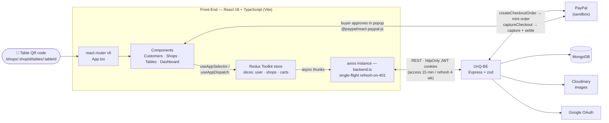

- **Entry**: `src/index.tsx` → `src/App.tsx`, which owns routing (`react-router-dom` v6) and switches between the customer `NavigationBar` and the manager `ShopNavbar`.
- **State**: Redux Toolkit, one slice per domain — `user` (auth/profile + `status: "idle" | "loading" | "authenticated" | "guest"`), `shops` (venues, menu items, tables), `carts` (table cart + per-item split state). Components read/dispatch through the typed hooks in `redux/app/hooks.ts` (`useAppDispatch`/`useAppSelector`) rather than the bare react-redux hooks.
- **API access**: exclusively through the axios instance in `src/backend/backend.ts` (`withCredentials: true` — auth lives in httpOnly cookies, never in JS-readable storage). A response interceptor there transparently refreshes an expired access token on a 401 (single-flighted, so concurrent 401s share one refresh call) and replays the original request once.
- **Shared types**: `src/typings/`.
- **Env vars**: `VITE_BE_URL` (back-end base URL) and `VITE_PAYPAL_CLIENT_ID` (PayPal sandbox/app client ID) — see [Environment Variables](#environment-variables).

```
src/
├── App.tsx                 routes + top-level nav switch
├── index.tsx                entry point
├── backend/
│   └── backend.ts           axios instance + refresh-on-401 interceptor
├── redux/
│   ├── app/                 store + typed hooks
│   └── slices/               user, shops, carts
├── components/
│   ├── Customers/            table menu, cart, split/checkout, navbar
│   ├── Shops/                 shop details/menu/items (manager CRUD)
│   ├── Tables/                table list + QR-code generation
│   ├── Dashboard/             post-login landing (shop list / customer view)
│   ├── Login/ Register/       auth forms
├── typings/                  shared TS types (cart, menu, shop, user)
└── tests/                    Vitest + Testing Library + msw suite
```

<p align="right">(<a href="#top">back to top</a>)</p>

<!-- SETUP -->

## Setup

### Prerequisites

- Node.js ≥ 20
- A running instance of [UnQ's Back-End](https://github.com/Nando-C/UnQ-BE) (anything behind auth needs it — see its own README for setup)

### Environment Variables

Copy `.env.example` to `.env` and fill in:

| Variable | Description |
|---|---|
| `VITE_BE_URL` | Path the app calls the back-end on. Keep it as `/api` so the API is served from this app's own origin and the back-end's auth cookies stay first-party (see [Deployment](#deployment)) |
| `DEV_PROXY_TARGET` | Where the dev server forwards `/api`. Defaults to `http://localhost:3001`. Deliberately un-prefixed so it never reaches the client bundle |
| `VITE_PAYPAL_CLIENT_ID` | PayPal client ID for the checkout button (falls back to PayPal's shared `"sb"` sandbox ID if unset) |

### Scripts

| Script | Description |
|---|---|
| `npm run dev` / `npm start` | Start the Vite dev server on `:3000` |
| `npm run build` | Type-check, then build the production bundle to `dist/` |
| `npm run preview` | Preview the production build locally |
| `npm run lint` | Run ESLint over `src` |
| `npm test` | Run the Vitest suite once |

### Deployment

The front-end deploys to [Vercel](https://vercel.com/); the back-end runs separately.

- **The build output directory is `dist/`** (Vite), not CRA's `build/` — set it in the Vercel project settings or the first deploy serves nothing.
- **The API is proxied through this app's own origin.** `vercel.json` rewrites `/api/:path*` to the back-end, and `VITE_BE_URL` must be set to the relative path `/api` (in the Vercel project's environment variables, not the back-end's URL). This is not cosmetic. The back-end sets its JWT cookies `Secure; SameSite=None`, which is correct for cross-origin — but when the two apps sit on different registrable domains, Safari's Intelligent Tracking Prevention blocks those cookies as third-party regardless of `SameSite`. Served through this origin they are first-party, and Safari accepts them with no user intervention.
- **Google OAuth has to point at the proxied path too.** The back-end builds its Google callback URL from its own `BACKEND_URL`, so that variable must be the proxied prefix — `https://un-q.vercel.app/api` in production, `http://localhost:3000/api` in development — and the same URL with `/auth/googleRedirect` appended must be registered as an authorized redirect URI in the Google Cloud Console. Leave `BACKEND_URL` pointing straight at the back-end and Google returns the browser to the back-end's own domain, where the cookies get set out of reach of this origin: Google sign-in then fails silently in *every* browser, not just Safari.

Local development reproduces the same shape through Vite's dev-server proxy (`vite.config.ts`), which forwards `/api` to `DEV_PROXY_TARGET`.

<p align="right">(<a href="#top">back to top</a>)</p>

<!-- TESTING -->

## Testing

The suite is written with Vitest, React Testing Library, and msw (mocking the back end at the network layer, no real requests). It covers the auth forms' validation and error mapping, the silent-refresh interceptor, cart total math, the navbar order badge, and the manager item form's category/price validation.

<p align="right">(<a href="#top">back to top</a>)</p>

<!-- USAGE EXAMPLES -->

## App Use

The main idea behind this application is to provide the venue with a unique QR-code per table or Point Of Service/POS (which is generated automagically by the app), so when the customer wants to place an order, simply scan the QR code select the items and pay.

So for this purpose, the app has two user interfaces:

- Customer

  Used by the customers to order and pay for Food & Drinks and designed to be only mobile.

  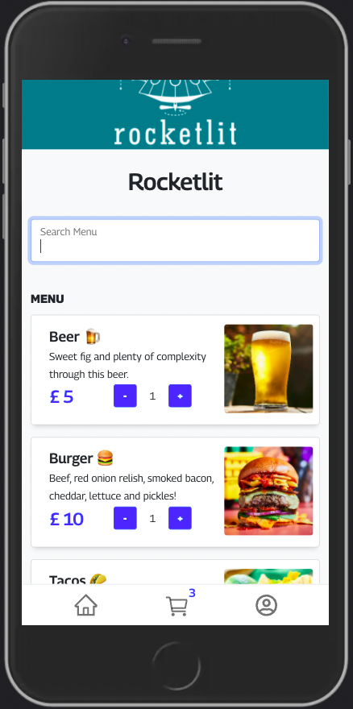

- Venue / Shop

  Used by the venue's/shop's staff to create and edit the place profile, i.e contact details, modify the menu, create table/POS QR-codes (and in the next version, get some sales analysis).

  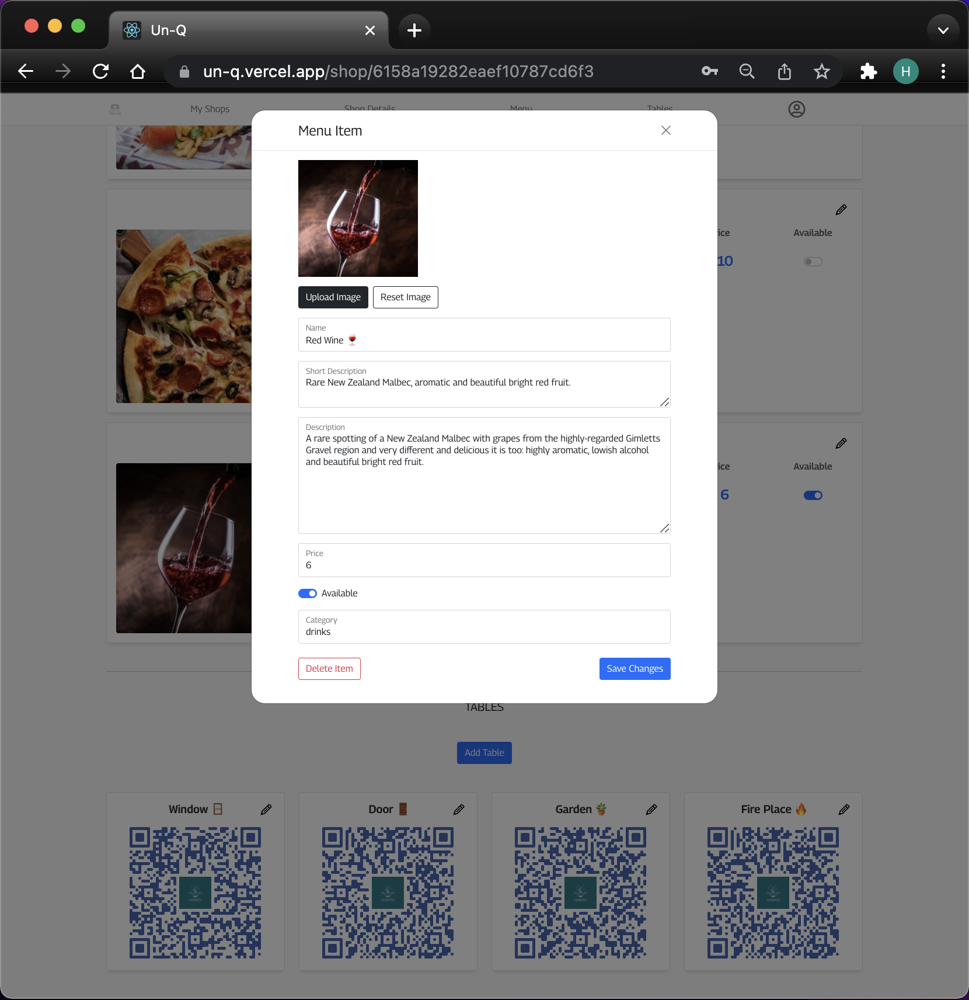

<p align="right">(<a href="#top">back to top</a>)</p>

### Customer Interface

- Ideally you will land here by having scaned a venue's QR-code on your mobile, which places you right in the specific table/POS your are sitting within the venue/shop.

- You will see the venue's availble menu and will be able to add items to the cart right away.

    

- In case you land here following different route, you will have a list of venues to choose from. Then you'll have to first select the table/POS you are sitting, before being able to add items to the cart.

    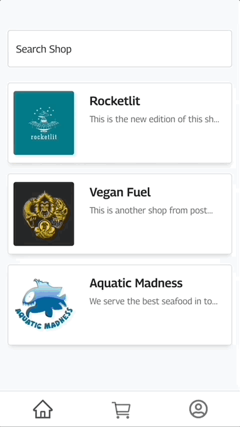

<p align="right">(<a href="#top">back to top</a>)</p>

#### Cart

- On the cart, you have the option to select all items and pay for the full bill or select the quantities of the ones you want to pay for, to share the bill with your friends. In the second case, your friends can scan the QRcode with their phones to select the remaining items, or use the same phone to do so and pay with their own card.

    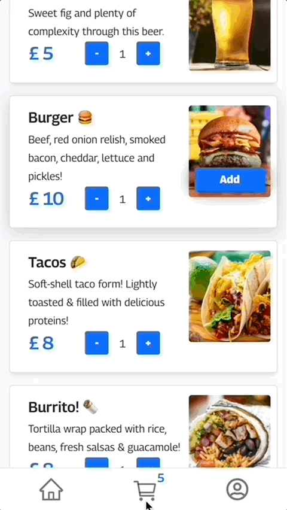

<p align="right">(<a href="#top">back to top</a>)</p>

#### Payment

- As for payment options, you can use your paypal account or your prefered Debit or Credit Card.

    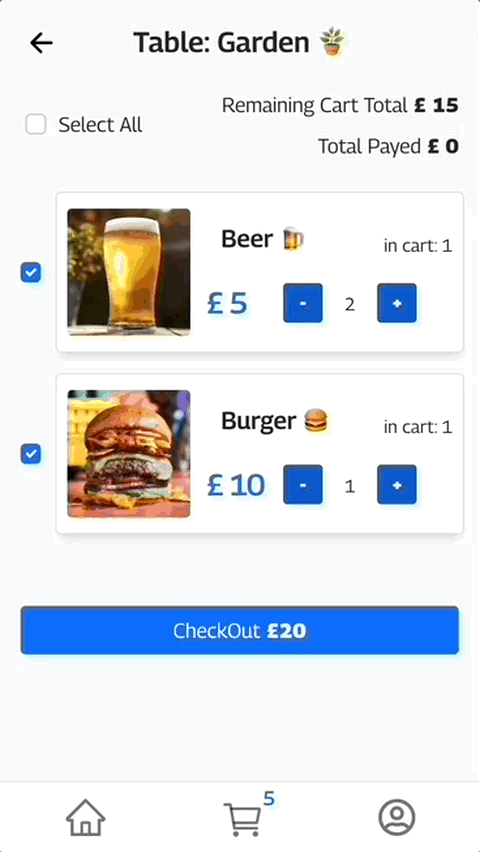

<p align="right">(<a href="#top">back to top</a>)</p>

#### Try Customer Interface

- As mentioned before, this interface has been designed to be mobile only.

- The best way is to access the app through the following QR-code, by scaning it with your mobile's phone camera. (Or tap it, if you are viewing this on a phone). This simulates that you are scanning a QR-code on the Fire Place 🔥 table of the Rocketlit venue (fictional place).

  <a href="https://un-q.vercel.app/shops/6158a19282eaef10787cd6f3/tables/61702525cc1ec6af70a92f35" target="_blank"></a>

- When you try to add an item to the cart, you will be prompted to login/sign up. You can create an account if you wish, or you can use the following details.

        Email address: frank@mail.com
        Password: 1234

- You can test payments using the following paypal demo account details:

        user: test@unq.com
        password: 12345678

<p align="right">(<a href="#top">back to top</a>)</p>

### Venue Interface

- When a user login with a venue's manager account, a list of your venues/shops will be displayed (in case you have many branches) and a button to create a new one if you are expanding or participating on a pop-up market.

    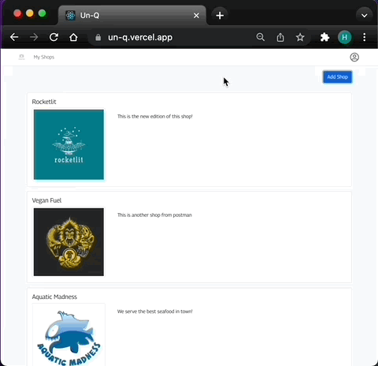

- Once a particular venue has been selected, you have access its details, menu and available tables sections.

    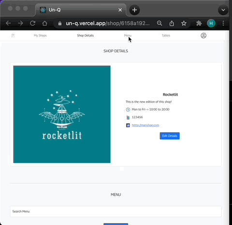

<p align="right">(<a href="#top">back to top</a>)</p>

#### Details

- On the details section, you will be able to update the venue's information and/or delete the venue (i.e: if the pop-up market has finished)

    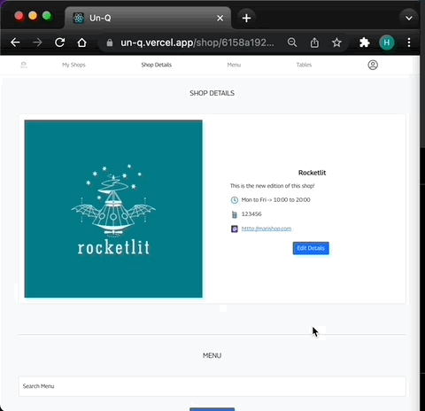

<p align="right">(<a href="#top">back to top</a>)</p>

#### Menu

- On the Menu section, you have a search bar to quickly fin a specif item, a button to add a new item and the list of items on your menu.

- Also, on each item you have a toggle button to quickly change the availability of that item in case you run out of stock.

    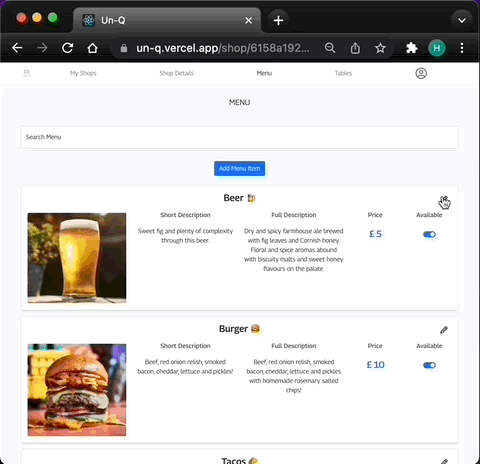

<p align="right">(<a href="#top">back to top</a>)</p>

#### Tables

- On the tables section, you can create a new table by giving it a name, and the app will automatically generate a unique QR-code, customised with the image/ of the venue. This QR-code then can be saved and printed to place it in the respective location.

    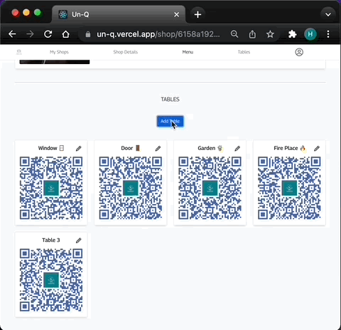

<p align="right">(<a href="#top">back to top</a>)</p>

#### Sales Analysis

An insight into product sales performance of the venue will be availble in the next release.

🛠 Watch this space! 👀

<p align="right">(<a href="#top">back to top</a>)</p>

#### Try Venue Interface

- To try the venue interface, you can open the app on the following link

  [UnQ](https://un-q.vercel.app/)

- Login with the the following details:

        Email address: manager@mail.com
        Password: test

<p align="right">(<a href="#top">back to top</a>)</p>

<!-- CONTACT -->

## Contact

[@Nando](https://hernando-crespo.vercel.app/) - I think this is amazing but I might be biased! So get in touch and let me know what do you think of this project! 😉

<p align="right">(<a href="#top">back to top</a>)</p>
