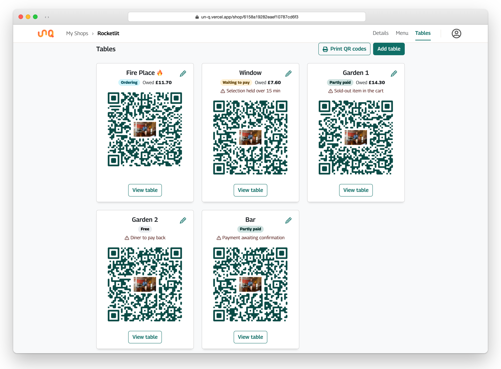
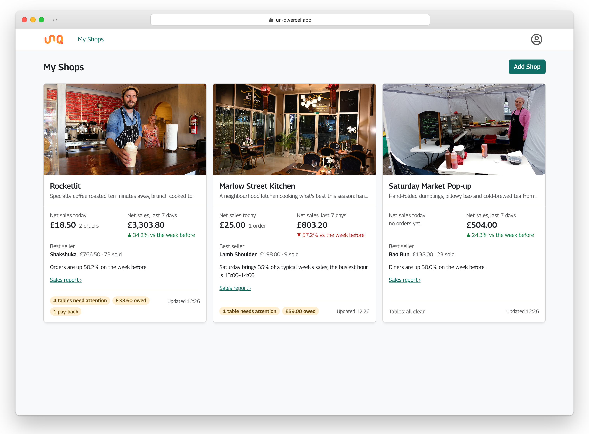
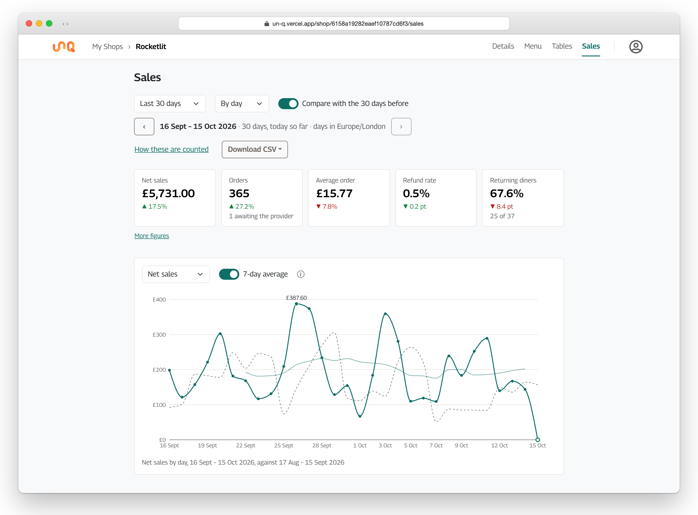
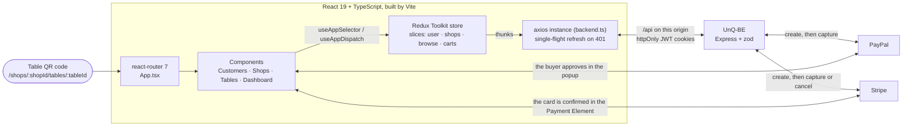

# UnQ

Scan the QR code on your table, order into a cart you share with everyone sitting there, and pay for exactly the items you picked, by card, Apple Pay, Google Pay or PayPal. No app to install, no waiter to wait for. The venue runs its menu, tables and payments from the same site. This is the web client; the API is [UnQ-BE](https://github.com/Nando-C/UnQ-BE).

React 19 · TypeScript 6 · Vite 8 · Redux Toolkit · React Router 7 · React-Bootstrap · Recharts · Stripe Payment Element and PayPal · Vitest with Testing Library and msw

[](https://github.com/Nando-C/UnQ-FE/actions/workflows/ci.yml)
[](./LICENSE)
[](./CHANGELOG.md)

<p>
  
  
</p>

## Try it

The demo runs at [un-q.vercel.app](https://un-q.vercel.app). Its API sleeps on a free tier, so the first page can take up to a minute to answer; after that it is quick. Payments run in test mode: nothing is charged. The data is rewritten every night: the venues keep ninety days of history ending yesterday, and whatever was ordered at them the day before is gone by morning; an account you create stays.

**As a diner, on your phone.** Scan the code below with your camera, or tap it if you are reading this on a phone. It puts you at the Fire Place table of Rocketlit, a demo café.

<a href="https://un-q.vercel.app/shops/6158a19282eaef10787cd6f3/tables/61702525cc1ec6af70a92f35"></a>

Adding an item asks you to sign in. Create an account, sign in with Google, or use the demo diner, `frank@mail.com` with the password `UnqTester1`. Pay by card with Stripe's test card `4242 4242 4242 4242`, any future expiry and any CVC (`4000 0025 0000 3155` asks for a bank check first, `4000 0000 0000 0002` is declined). PayPal runs against its sandbox and needs a sandbox buyer account.

**As the venue, on a laptop.** Sign in as `manager@mail.com` with the password `UnqManager1`. Three venues are yours, with ninety days of payments behind them. Each card shows the venue at a glance: today so far, the last seven days against the seven before, the week's best seller, a highlight, and what its tables need right now. Open a venue's Sales tab for the trend, the busy hours, what the menu earns, refunds by cause and the highlights written from those figures. Rocketlit's tables show every state at once: one being ordered at, a selection held too long, a sold-out item in a cart, a payment the provider is still holding, a diner still to be paid back, and a deleted table whose last cart can still be refunded.





## What it has to get right

**The client never prices, never captures, and never shows a diner something that isn't true.** The cart belongs to the table, not to a person. Several phones add to it and pick from it at the same time, prices can change while it is open, an item can sell out after it was added, and a card payment can be interrupted by a bank check or a closed tab. The client has to feel instant and still be right. It tells the truth about every outcome and keeps that truth on screen, and when two answers arrive for the same question the latest request wins. Selections are the one place it is optimistic, because a stepper that waits for a round trip feels broken. How the checkout holds all of that together, outcome by outcome, is in [docs/checkout.md](./docs/checkout.md).

## Engineering decisions

Each with its reason and what it costs; the dated log is [docs/ux-decisions.md](./docs/ux-decisions.md).

- **The API is served from this origin.** Its cookies are `Secure; SameSite=None`, right for a cross-origin API, but Safari drops third-party cookies regardless. Vercel rewrites `/api` to the API and Vite's dev server proxies it, so the cookies are first-party everywhere. Cost: the API's `PUBLIC_API_URL` and its CORS origins must name this origin, and nothing complains when they don't; [deployment.md](./docs/deployment.md) spells them out.
- **No token ever reaches JavaScript.** One axios instance sends cookies and nothing else; a 401 triggers one refresh, shared by every request that hit it, and a replay. A refresh another tab won a moment earlier is recognised and resent. Cost: the refresh dance lives in one file, and nowhere else by rule. [architecture.md](./docs/architecture.md#data-flow)
- **The client never prices anything.** The API computes every amount from the database; the client shows it. Stripe's form is confirmed only if the amount the API created equals the one the diner saw, compared in whole pence. Cost: a price change between opening the sheet and pressing Pay asks for a second press rather than charging the new total. [checkout.md](./docs/checkout.md)
- **Optimistic where a round trip would feel slow, and nowhere else.** A tap on the stepper moves the count at once; a loop per item brings the API round, one request at a time, and rolls back on refusal. Everything else waits for the API. [ux-decisions.md](./docs/ux-decisions.md)
- **The latest request wins.** Every fetch that can overlap is numbered and its answer applied only if nothing newer was asked for since, so a slow answer never overwrites a newer screen and a failed probe never signs a manager out. Cost: five small implementations of one idea, listed in [known-gaps.md](./docs/known-gaps.md) to unify. [architecture.md](./docs/architecture.md#state-four-slices-one-store)
- **Honest outcomes that stay.** A refusal before money moved says nothing was charged; a lost answer after a capture never claims either way; a card payment the API couldn't confirm is "being confirmed", not failed, and the cart is looked at again. Every outcome stays until the diner closes it. [checkout.md](./docs/checkout.md#outcomes)
- **Sold-out items are shown, not hidden.** A diner sees why an item can't be added, and one that sold out after it was added stays in the cart flagged, never charged, until it is removed. [ux-decisions.md](./docs/ux-decisions.md)
- **Layout is tested, not eyeballed.** A headless-Chrome audit renders the main screens from 320px to 1440px and at 200% text against a mocked API and fails on overflow, content spilling out of its card or sheet, controls under 24px, and content hidden under a fixed bar. [responsive-and-a11y.md](./docs/responsive-and-a11y.md)

## Architecture



```
src/
├── App.tsx                 the routes and the shell: the diner's tab bar or the manager's header, by role
├── backend/backend.ts      the one axios instance and its refresh interceptor
├── redux/                  the store, typed hooks, four slices (user, shops, browse, carts)
├── lib/                    shared helpers and hooks: errors, prices, the outcome mapping, sign-in gating
├── components/             Customers (menu, cart, checkout), Shops and Tables (the manager), Common
├── styles/theme.scss       Bootstrap recompiled with the UnQ palette
├── typings/                shared types
└── tests/                  the Vitest suite, its msw server and helpers
scripts/                    the responsive audit, the API contract test, its fixture and refresher, the docs test, the style-import test, the screenshot tool
docs/                       the design knowledge, and the screenshots
```

**How the two apps talk.** The browser loads the app from Vercel and calls `/api` on the same origin, which Vercel rewrites to the API. The API answers with two httpOnly cookies, a fifteen-minute access token and a four-week refresh token. On a 401 the axios interceptor refreshes once, queues every other request behind it, and replays them. At checkout the client asks the API to create the payment, lets the diner confirm with the provider, and asks the API to capture; the sequence is drawn in the API's [api.md](https://github.com/Nando-C/UnQ-BE/blob/main/docs/api.md#checkout-at-a-glance). If the API can't answer at once, the table's notices tell the diner how it ended on their next visit. The whole map is [docs/architecture.md](./docs/architecture.md).

## Quick start

Node 22.12 or later. The suite and the build need nothing else; anything behind sign-in needs the [API](https://github.com/Nando-C/UnQ-BE) running, by default on `localhost:3001`.

```bash
git clone https://github.com/Nando-C/UnQ-FE.git && cd UnQ-FE
npm install
cp .env.example .env     # the defaults work for local development
npm run dev              # http://localhost:3000, /api proxied to DEV_PROXY_TARGET
```

Card payments need `VITE_STRIPE_PUBLISHABLE_KEY`, the [test publishable key](https://dashboard.stripe.com/test/apikeys) of the account whose secret key the API holds; without it the checkout offers PayPal only. PayPal uses the client id of the API's [sandbox app](https://developer.paypal.com/dashboard/applications/sandbox), or PayPal's shared sandbox id when unset. A manager account comes from the API's `npm run seed:demo`, or by giving an account the `shopMg` role in the database.

### Environment variables

| Variable | Description |
|---|---|
| `VITE_BE_URL` | The path the app calls the API on. Keep it `/api`, so the API is served from this origin and its cookies stay first-party |
| `DEV_PROXY_TARGET` | Where the dev server forwards `/api` (default `http://localhost:3001`). No `VITE_` prefix on purpose: it never reaches the bundle |
| `VITE_PAYPAL_CLIENT_ID` | PayPal client id for the checkout button; PayPal's shared `sb` sandbox id when unset |
| `VITE_STRIPE_PUBLISHABLE_KEY` | Stripe publishable key of the API's account; unset, the checkout offers PayPal only |

### Scripts

| Script | What it does |
|---|---|
| `npm run dev` | The Vite dev server on `:3000` |
| `npm run build` / `npm run preview` | Type-check and build to `dist/`; serve the build |
| `npm test` | The Vitest suite once |
| `npm run lint` | ESLint over `src/` |
| `npm run audit:responsive` | The layout audit in headless Chrome |
| `npm run contract:refresh` | Refresh the API contract fixture from the dev server's `/openapi.json`, or a URL or file given as its argument |
| `npm run shots -- --env=<file>` | Retake the screenshots from the live demo |

## Testing and CI

The suite runs with Vitest, React Testing Library and msw, which answers every request at the network layer and fails a test that makes one it didn't expect. It covers the sign-in forms and the silent refresh, the cart's split selection and totals, both checkouts with every outcome the API can answer, the manager's table sheet with its releases, refunds, payment checks and pay-backs, the paged shop search, sold-out handling, every page's loading and failure states, and the ordering of overlapping requests. Two tests look after the repository: every URL the client calls must be an operation in the API's OpenAPI document, kept as a fixture and refreshed each release, and every Markdown link and the environment table must resolve. Layout is checked separately by `npm run audit:responsive`, which renders the main screens at eight viewports, one of them a phone with text at 200%.

```bash
npm test
```

CI runs the lint, the suite and the build, which type-checks first, on Node 24 for every push to `main` and every pull request. No API and no secrets are needed. A second check fails a pull request that changes the code without a word in the changelog or the docs, unless it is labelled `no-docs`. The gates, how the suite is built and what it doesn't cover are in [docs/testing.md](./docs/testing.md); the release steps in [docs/deployment.md](./docs/deployment.md#releasing).

## Documentation

- [docs/architecture.md](./docs/architecture.md): the routes, the tree, the four slices and the "latest request wins" rule, data flow, the styling layers, the build.
- [docs/checkout.md](./docs/checkout.md): selecting what to pay, the card and PayPal flows, and the table of every outcome a diner can see.
- [docs/manager-tools.md](./docs/manager-tools.md): the shop page, the editors, the tables and the table sheet's actions, word for word.
- [docs/sales.md](./docs/sales.md): the sales page as a case study: the questions, the chart that answers each, the counting rules, the highlights' rules, the demo's patterns.
- [docs/ux-decisions.md](./docs/ux-decisions.md): why it is the way it is, dated.
- [docs/responsive-and-a11y.md](./docs/responsive-and-a11y.md): what holds at every size, touch, focus, colour, and the audit.
- [docs/deployment.md](./docs/deployment.md): hosts, configuration, the settings on the API's host, the release order.
- [docs/testing.md](./docs/testing.md): the gates, how the suite is built, what it covers.
- [docs/known-gaps.md](./docs/known-gaps.md): accepted residuals, open bugs, deferred work, roadmap.
- [CHANGELOG.md](./CHANGELOG.md): every release, with its deploy notes.
- [SECURITY.md](./SECURITY.md): how to report a vulnerability, and what the demo is for.

## Roadmap

Staff on a shop is in; next are staff roles, and kitchen screens with live updates; the list and its order are in [known-gaps.md](./docs/known-gaps.md#roadmap).

## About

UnQ began as a five-week solo capstone in 2021 and was rebuilt in 2026: Create React App to Vite, React 17 to 19, the refresh interceptor, the shared-cart selection, card payments beside PayPal, the manager's tools, the test suite and the layout audit. Released under the [MIT licence](./LICENSE).

[Hernando Crespo](https://hernando-crespo.vercel.app/) · [the API](https://github.com/Nando-C/UnQ-BE) · [the live demo](https://un-q.vercel.app)
