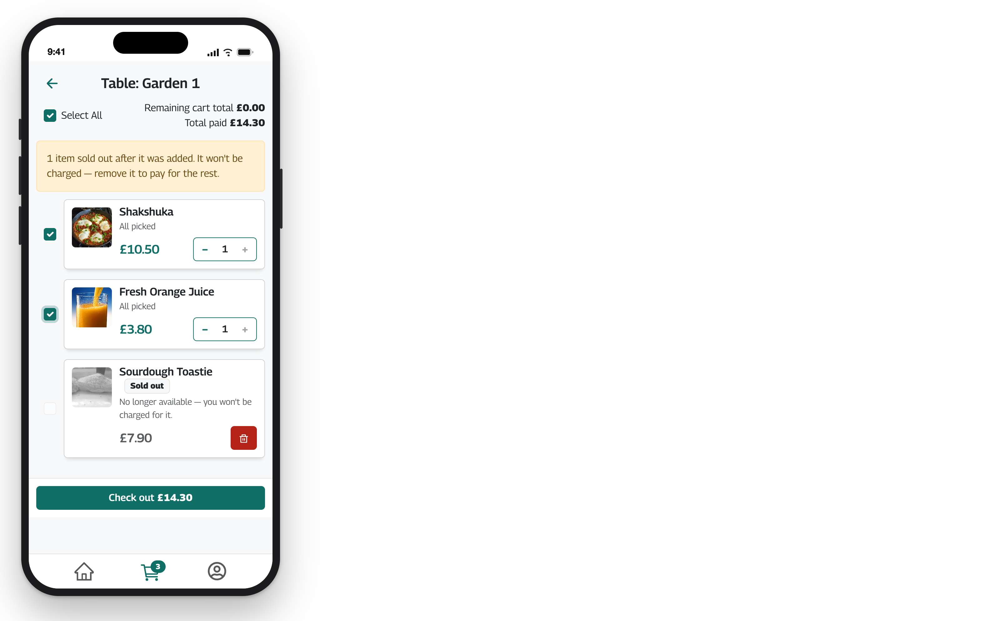
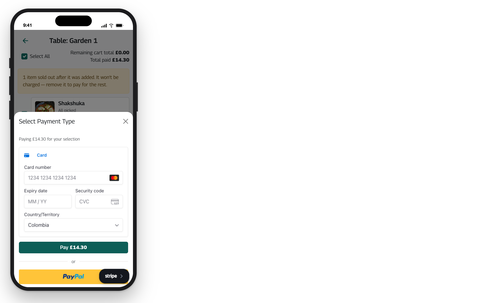
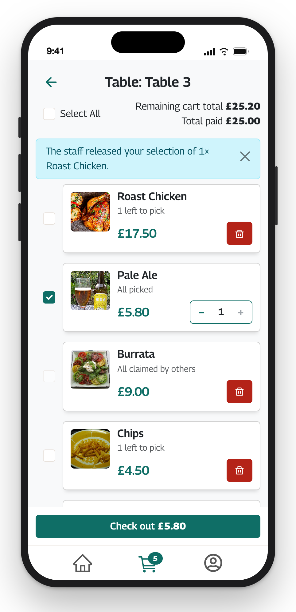

# Checkout

How a diner picks what to pay for and pays, and every message they can see about it. Read from `src/components/Customers/CartListItems`, `CartItem`, `CheckOut`, `CardPayment`, `Cart` and `PaymentFeedback`, `src/redux/slices/cartSlice.ts`, `src/lib/paymentOutcome.ts`, `lib/stripe.ts`, `lib/price.ts` and `lib/cart.ts`. The API's side (reserving, charging, refunding, the webhook) is in [UnQ-BE's payments.md](https://github.com/Nando-C/UnQ-BE/blob/main/docs/payments.md).

## The rules the client keeps

1. **The client never prices anything that is charged.** The API creates every payment from database prices. The client shows the diner's own selection at the prices in the cart it loaded, and for a card payment confirms Stripe's form only if the API's amount equals the one shown. Money is compared in integer pence (`lib/price.ts` `toPence`), never as floats.
2. **The client never captures.** PayPal's popup and Stripe's form only authorise; the API captures after re-checking the cart, and the client asks it to.
3. **A refusal before money moved says so.** Any 4xx from a checkout step ends with "nothing was charged" and the cart is fetched again, so the diner sees why (a sold-out item, a selection staff released, a closed table).
4. **No answer is not a failure.** A card payment the API couldn't confirm in time may still go through, finished by Stripe's webhook. The diner is told it is being confirmed, not to pay again, and the cart is looked at again later.
5. **Every outcome stays on screen until the diner closes it.** A success is a money confirmation; a failure may carry the id staff need.

## Selecting what to pay

The cart is the table's, shared by everyone at it. Each unpaid unit can be **selected** by one diner at a time (an open *split* on the API). A row's checkbox selects one unit; its −/+ change how many; "Select All" takes every unit still free. What a diner can still take of an item is `availableQty`: ordered, minus paid, minus what other diners hold.

**Selections are optimistic** (`cartSlice.ts`, `setSplitQty`). A tap sets the wanted count for that item in `pending` and the row shows it at once. One loop per item then brings the API round to it, one request at a time, re-reading the wanted count after every answer, so a burst of + becomes one `addSplitItem` for the difference and taps never race each other. On a refusal the wanted count is dropped, the cart is fetched again and the row says why: "Sorry, that just sold out.", "Not enough left, someone else just took it.", or "Couldn't update that, please try again.". Checkout is disabled while anything is still syncing.

The row's counter says what is left for anyone at the table to pick: "{n} left to pick", "All picked", or "All claimed by others". A row that sold out after it was added is greyed with a "Sold out" badge, can be cleared but not newly selected, is never counted in a total, and must be removed before the rest can be paid for: the checkout button then reads "Remove sold-out items to check out".

The totals: **Total paid** sums closed splits at the price each unit was paid at (`unitPrice`; older payments fall back to the menu price). **Cart total** or **Remaining cart total** is what's unpaid at today's prices, less what anyone has selected. The checkout button carries only **my** selection, since that is what the API will charge.

The bin removes an item's unpaid units for the whole table, except units other diners have selected ("{n} kept: someone at the table is paying for them."); − orders one fewer. A 204 means the emptied cart was deleted, and the page shows "No open orders".

## The checkout sheet

Opens from the checkout button. Both providers' scripts load then, not before. With `VITE_STRIPE_PUBLISHABLE_KEY` set the sheet shows Stripe's card form first (Card open; Apple Pay and Google Pay as rows under it where the device and the registered domain allow), then "or" and PayPal's own button alone (`fundingSource: "paypal"`: no Pay Later, no card through PayPal). Without a key, PayPal's buttons as it draws them, card button included, are the only way. A line under the title says the amount for both: "Paying £X for your selection".

While one method is busy the other is disabled, and the sheet cannot be closed while a card is being confirmed (a bank check may be open over the page).

### Paying by card

Stripe's Payment Element runs in deferred mode: it is mounted with the amount, currency (GBP), manual capture and cards only, and **nothing is created anywhere until the diner presses Pay**. The press (`CardPayment.tsx`):

1. `elements.submit()` first, synchronously, before any await: Apple Pay and Google Pay open their sheet from it and need the tap. A validation error stays in Stripe's form; any other stops here, under the form.
2. The amount and cart shown at the press are snapshotted; a refetch landing meanwhile changes neither what is checked nor what the form shows.
3. `POST …/createStripeCheckout`: the API creates a PaymentIntent for the caller's selection at its prices and answers `clientSecret`, `paymentIntentId`, `amount` (pence). A 4xx other than 429 closes the sheet with the refusal (as PayPal would be refused). A 429 or 5xx keeps the sheet open: "Couldn't start the card payment. Try again in a moment, or pay with PayPal."
4. **The amount check**: if the API's amount differs from the one pressed, nothing is confirmed. "The total is now £X — check it and press Pay again." The cart is fetched again so the button and the form follow the API's prices; the unconfirmed intent is left for the API's sweep to cancel.
5. `stripe.confirmPayment` with `redirect: "if_required"` and a return URL that names the cart. A decline, a form error or a failed bank check (`isRetryableCardError`) stops under the form so the diner can try another card; the next press creates a new intent. Any other error (a connection error, which can come after the card was authorised) goes on to the capture, whose answer comes from the payment as Stripe has it.
6. `POST …/captureStripeCheckout`: the API re-checks the cart and takes the money, or cancels the authorisation. Its answer closes the sheet and shows the outcome (below). Opening the sheet again starts afresh.

A bank check that takes the diner off the page (rare: Stripe.js runs it over the page) returns to the cart page with `?cart=<id>&payment_intent=<id>`; `Cart.tsx` calls the capture once with that cart, cleans the URL at once so a refresh doesn't ask again, and shows the outcome. A diner who never comes back is told by the table's notices on their next visit, written by the API's webhook.

### Paying with PayPal

`createOrder` → `POST …/createCheckoutOrder` (the API mints the order for the caller's selection) → PayPal's popup → `onApprove` → `POST …/captureCheckout` with the order id → the outcome. Closing the popup is "Payment cancelled — nothing was charged." A `createOrder` refusal is kept on a ref, because PayPal's `onError` only gets a generic Error, and shown as "not started".

## Outcomes

One mapping for both providers (`lib/paymentOutcome.ts`), from the capture's status, message and `reason` to a sheet with a title, an icon and the message, whether the cart is fetched again (`refetch`), and whether it is looked at again later (`recheck`, cards only: Stripe's webhook or the sweep finishes an unanswered payment). Titles: **Payment successful**, **Payment not completed**, **Payment under review**, **Confirming your payment**.

| The API answered | Shown | Refetch | Recheck |
|---|---|---|---|
| `200` | success: "Your payment went through." | no | no |
| `202` (the provider took it but hasn't confirmed it) | pending: PayPal "…is still reviewing your payment. Your items are held for you until staff confirm it — please don't pay for them again." / Stripe "…is still confirming your payment. Your items are held for you — please don't pay for them again." | no | Stripe only |
| `401`/`403` on a card capture (the session ended during the bank check) | confirming: "We couldn't check your card payment because you're signed out. Sign in to see how it went — until then, please don't pay for these items again." | no | yes |
| `409` whose message says "your payment was refunded" (a concurrent payer took the units after capture; the API refunded) | failure: the API's message | yes | no |
| `402` | failure: "Payment could not be completed — nothing was charged. Please try again." | no | no |
| `reason: CART_GONE` / `CART_GONE_PENDING` (a card payment went through, or is being confirmed, on a cart deleted since; also told by the 404's wording) | success / pending: the API's message, never "nothing was charged" | yes | no |
| any other `4xx` | failure: "{message} — nothing was charged." | yes | no |
| `reason: STILL_CONFIRMING` (the API can't tell yet; its webhook or sweep will) | confirming: the API's message | no | yes |
| `5xx` or no answer, message explains itself ("contact staff", "(payment …)") | failure: the API's message | no | no |
| `5xx` or no answer, card, no explanation | confirming: "We couldn't hear back about your card payment. Your cart will update once it's confirmed, and you'll get a note if it doesn't go through — until then, please don't pay for these items again." | no | yes |
| `5xx` or no answer, PayPal, no explanation | failure: "We couldn't confirm your payment — please contact staff before paying again." | no | no |
| a refusal at `create…` (before anything was charged) | failure: "{message} — nothing was charged." or "Payment failed — nothing was charged. Please try again." | yes | no |
| PayPal's popup closed | failure: "Payment cancelled — nothing was charged." | no | no |

**Recheck** fetches the table's cart again 30 seconds and 3 minutes after the outcome, on the same table and for the same signed-in diner (moving to another table or signing out cancels it), so the cart shows the payment or the staff's note. A capture's cart is newer than any table fetch sent before it (the popup or the form sends focus back, which refetches), so those are dropped (`takeCapturedCart`); a card capture's cart shows only on its own table.

Closing a success goes to the table's menu, by path (not back a page, which could land on the sign-in form).

### Notices

The API attaches `notices` to the table's cart (and to its 404 when there is no open cart): what staff or the server did to this diner's table ("The staff released your selection of 2× Latte.", how an abandoned card payment ended). `CartNotices` shows the three newest the diner hasn't dismissed, above the list and on the empty cart, in one `role="status"` region. Dismissed ids are kept in `localStorage` (the last 50); without storage a note comes back until the API stops sending it.

## What the mapping relies on

Four refusals carry a machine-readable `reason` (`STILL_CONFIRMING`, `CART_GONE`, `CART_GONE_PENDING`, and `superseded` on a refresh). The rest are told apart **by their English**: the post-capture 409's "your payment was refunded", the 404's "this table's cart is no longer here", "contact staff" and "(payment " in a 5xx, "This item is sold out" and "Someone at the table is paying for those" on cart edits. Rewording any of them on the API would silently change what a diner is told. The markers live in one place each (`paymentOutcome.ts`, `cartSlice.ts`, `CartItem.tsx`, `MenuItem.tsx`) until the API gives every one a `reason`: the open bug in [known-gaps.md](./known-gaps.md).
