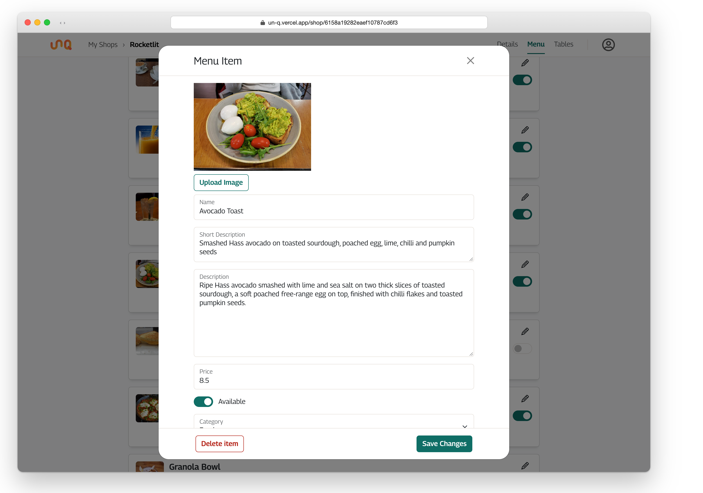
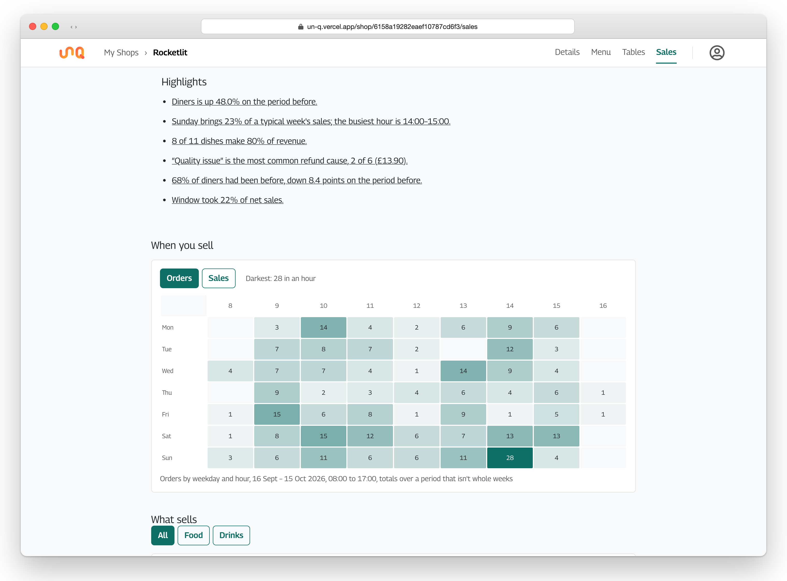
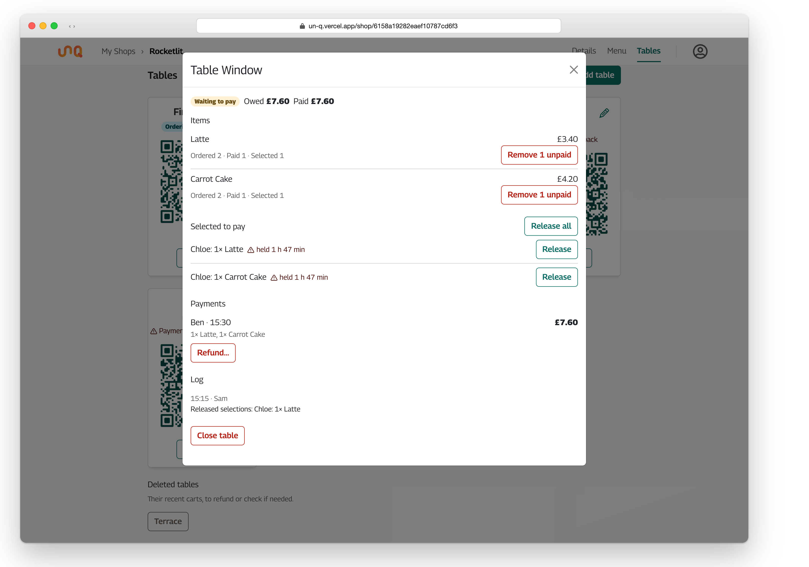
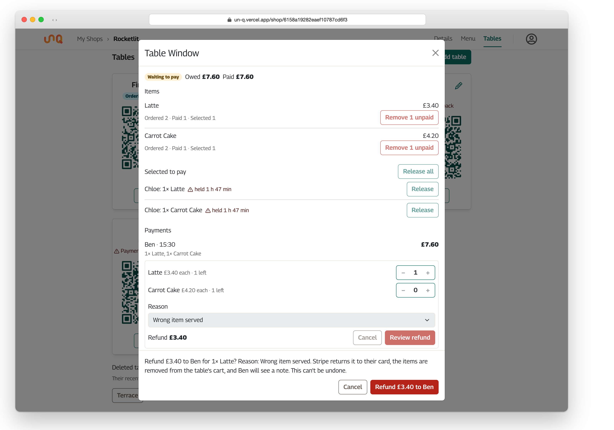
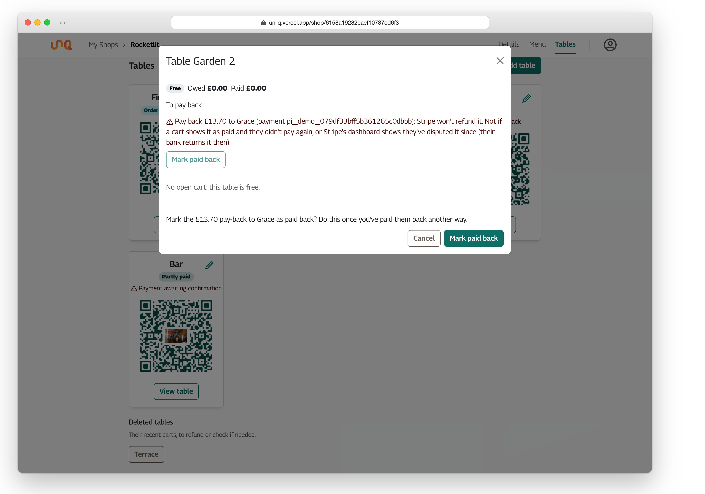

# Manager tools

What a shop manager can do from the app and how each screen does it. Read from `src/components/Dashboard`, `Shops/` and `Tables/`, `src/redux/slices/shopSlice.ts`, `src/lib/tables.ts`, `lib/refundReasons.ts`, `lib/paybacks.ts` and `lib/providers.ts`. The manager routes themselves, with every status and message, are in the [API's OpenAPI document](https://github.com/Nando-C/UnQ-BE/blob/main/docs/api.md) under "Manager: tables" and "Manager: refunds and payments"; what the API does about money is in [its payments.md](https://github.com/Nando-C/UnQ-BE/blob/main/docs/payments.md).

A manager is whoever runs a shop: an account with the `shopMg` role (a shop manager, who may create shops) or the `admin` role (an administrator, who may do everything on every shop and is never a member of one), or a member of a shop, added by its owner (or an administrator). Neither role comes from the app's own sign-up (its role selector was dead UI and went in 2.0.0): an administrator gives them, and the first administrator is set in the database. Running a shop swaps the shell: a fixed header with a breadcrumb ("My Shops › First Shop"), the shop's section tabs (Details, Menu, Tables), and the account icon. The tabs follow the scroll (`ShopSectionNav`, `lib/sections.ts`) and move onto a row of their own below 640px.

## My Shops

`Dashboard` for a manager: `GET /shops/me` into the `shops` slice (the shops the account is a member of; every shop for an administrator, unpaged), shown as the same photo-on-top card grid diners see on their home page, so a manager sees their shops the way customers will; the photo and the name open the shop's page. "Add Shop" opens the shop editor for a shop manager or an administrator (a member of someone else's shop has no button). An administrator's new shop names its owner: the editor's Owner field searches the accounts by name or email as the text is typed (`GET /users?q=`, a page of ten with administrators left out, since one is never a member) and the pick is sent as `ownerId`; the owner runs the shop and adds its managers. The manager's own shops carry their full menus and tables (and the tables they deleted), which the shop page's menu, tables and editors read; the shop page loads them itself when opened directly.

Under each shop's name, the shop at a glance (`ShopGlance`, `lib/glance.ts`): two reads a minute while the page is visible, the sales report for today and the six days before against the seven before (`GET /shops/:shopId/sales?from&to&by=day&compare=previous`) and the tables' status (`GET /shops/:shopId/tables/status`). From the report, with the measure named as the Sales tab names it: **Net sales today**, with the orders of today's bucket, or only "no orders yet" in muted text, so a day not started doesn't lead with a bold zero; **Net sales, last 7 days**, with the change "vs the week before" in the sales page's colours and arrows (green up, red down, "no change", "new" when there is no week before); **Best seller**, the dish with the most revenue in the week, with its revenue and units ("Shakshuka · £283.50 · 37 sold", or "nothing sold this week"); then the first highlight the Sales tab would write for the week that the card doesn't already say (a net-sales mover is skipped, since the change beside the week says it), with "the period before" said as "the week before". The figures are one link to the Sales tab on the same week, captioned "Sales report ›" and named "Sales report for <shop>" for screen readers. The card's footer, pinned to the bottom so the cards in a row end together, is what the tables need from the status and the shop's deleted tables, as the badges the table cards wear, linking to the tables section: "4 tables need attention" (any flag a table card shows, a deleted table still needing a look included), "£33.60 owed" (at the open carts), "1 pay-back" (diners owed one); or, quietly, "Tables: all clear", with when the card was last updated on the right ("Updated 14:32", the clock of the device). The bio is clamped to one line on My Shops, so the figures sit near the name. Each read fails on its own ("Couldn't load the figures." / "the tables", with Try again) and leaves the other standing; a refresh that fails after figures were shown keeps them and says "Couldn't refresh." with Try again in the footer; while loading, placeholders in the figures' shape and a status line for screen readers. Every number comes from the API's answers; the card derives only the change.

## The shop page

`ShopDetails` loads the shop (`GET /shops/:shopId`) and shows, one after the other: the details card (cover in a 16:9 box kept from the start, bio, opening times, phone, web address), the **menu** with a search box and one row per item, and the **tables** as cards. Content is capped at 60rem so menu rows don't stretch across a desktop. While the shop loads, only its heading and placeholders show, and the page is swapped whole when it arrives, so nothing on screen is pushed down.

### The three editors

`ShopModal`, `ItemModal` and `TableModal` share one shape: a dialog (`fullscreen` below 576px, scrollable, the footer always in view) whose form **starts from the saved record each time it opens**, not from what was typed last time. Saving sends the fields, then the picture if one was picked (`lib/upload.ts`, a multipart `PUT` to the record's image route), then reloads the manager's shops. A picture that fails after the fields saved says so without undoing them: "The changes were saved, but the image wasn't: …". Create remembers the id it made, so pressing Create again after a failed upload saves to that record instead of making a second one; one create at a time, so a double tap sends one.

The shop editor's **time zone** is a select from the browser's list of IANA names (`Intl.supportedValuesOf`), the API's default `Europe/London` always among them: an existing shop shows the zone it was saved with (the default when none), a new one starts from the browser's own. Under it: "Sales are counted in the shop's own days: a day starts and ends on this clock."

The API's zod `400` is shown as its `details`, joined. The item editor checks the price is a positive number in whole pence before sending (refunds price each line, so a fraction of a penny wouldn't add up); categories are `food` or `drinks`, as the API's enum; a new item starts available.

**Deleting asks in the dialog's own footer** (`ConfirmFooter`, `lib/useConfirmDelete.ts`), not with the browser's `confirm()`: the question takes focus, says what is lost, and focus returns to the Delete button if it's cancelled or fails. Deleting a shop names its counts: "Delete {name}? This also deletes its 6 menu items and 5 tables, and their QR codes stop working. Its payment history goes too: refunds can then only be made from the payment provider." The API's refusals (a table with an open cart; a shop with money still moving) show as they are.

### The availability switch

Each menu row's switch flips `available` in the store before the `PUT` (`setMenuItemAvailability`), so it moves on the tap; a failed save puts it back with "Couldn't update availability — the switch has been put back." Diners see the item greyed out on their next load or focus.

## Sales

The **Sales** tab, a page of its own at `/shop/:shopId/sales`, reads the API's sales report (`GET /shops/:shopId/sales`) for a period of the shop's days: everything on the page comes from one answer, so a new period costs one request and a new metric none. The counting rules are the API's, in [UnQ-BE's api.md](https://github.com/Nando-C/UnQ-BE/blob/main/docs/api.md#sales-report): gross by the day paid, refunds by the day made, net the difference, all in the shop's time zone, which the page names.

- **The period**: a list of Today, Yesterday, This week, Last 7 days, This month, Last 30 days (the default), Last 90 days and "Custom range…" (two date fields, shown whenever the dates on screen are no preset). Under the list, the dates on screen sit between ‹ › arrows that step them, each arrow named for what it steps by ("Previous 30 days", "Next month"): a period's own length, or whole weeks and months for This week, This month and a range of whole months; a step that would reach past today stops at today, and the next arrow stops there too. "Today" is the shop's today, in its zone; a period that reaches it says "today so far".
- **Group by** day, week (from Monday) or month, picked from the range's length as the API does (days up to 92 days, weeks beyond) and changeable. **Compare with the period before** is on from a week; it adds each figure's change and the trend's ghost line.
- **Headline figures**: net sales, orders (with how many still await their provider), average order, refund rate, and the share of returning diners, each with its change on the period before: a percentage for money and counts, points for a rate, green when it is good news and red when it isn't (more refunds is bad news), grey for no change; "new" when there was nothing before, and "from −£30.00" when the period before was below zero (its refunds over its sales). Two cards per row on a phone, five from 768px.
- **The trend**: one line chart whose metric switches between net, gross, refunds, orders, average order, average visit, diners, units and refund rate without a request; the period before as a dashed grey line when grouped by day (a week or month at a range's edge is a partial bucket, so only days line up point for point; the headline figures compare the whole periods whatever the grouping); a 7-day average (from two weeks of days, on by default; each day as the mean of itself and the six before, starting on the seventh day, today left out; a circled i beside the switch says so) as a lighter line; the peak annotated with its value. A bucket that holds today is still being written: it is drawn as a hollow point, "so far" in its tooltip and the hidden table, and left out of the average and the peak; a brush to zoom from 32 buckets. Money and counts start at zero. The same numbers are in a visually hidden table under the chart.
- **Under the controls**: "How these are counted", a popover with the counting rules in the API's words (days in the shop's zone, gross by the day paid, pending apart, refunds by the day made, net, orders, visits, diners and returning, items net of refunds, the 7-day average a reading aid); and **Download CSV**, a menu of the period's Orders, Items and Days as files from `GET /shops/:shopId/sales/export`, fetched through the app's API client like every request (so a lapsed session is refreshed the usual way) and handed to the browser to save under the name the API gives; a failure says "Couldn't download the file: …".
- **More figures** under the cards opens four more: gross sales, refunds, visits and units sold, with their changes.
- **Highlights**: up to six sentences computed from the same answer, each a link to the chart it came from, in this order: the biggest mover among net sales, orders, average order and diners against the period before (from a 10% change); the weekday that brings the most sales, as its average day's share of a typical week, and the busiest hour (from a week); one dish carrying a fifth of revenue or more, else how few dishes make 80%; the most common refund cause with its count and amount, and the hour most refunds were made in when one hour has 40% of them (from three refunds); the share of diners who had been before and how it moved (from ten diners); the table that took the most net sales (from two tables); payments still awaiting their provider. A rule with nothing worth saying is silent. The rules are `lib/findings.ts`.
- **When you sell**: a weekday × hour grid of the hours with sales, from the first to the last, darker the busier, switchable between orders and sales; a cell's tooltip gives both. On a phone the cells are small and the grid scrolls sideways; from tablet widths it fills its card and each cell shows its figure. The cells are totals over the period; when the period isn't whole weeks the caption says so, since some weekdays then occur once more than others. Under a week the rows are the days present (one day is one row). The grid is a table, so its weekdays and hours are headers and every cell's figure is in it.
- **What sells**: a Pareto of the top twelve dishes by revenue with the running share of revenue as a line on the top axis (a circled i in the caption says so) and a marker where the dishes above it make 80%; a units-against-price scatter whose two medians sort the menu into stars (many at a high price), workhorses (many at a low one), puzzles (few at a high price) and sleepers (few at a low one), food and drinks in two shades; and "All items", a table of every dish (item, category, unit price, units, refunded, revenue) sortable by any column. A category filter (All, Food, Drinks, shown when the menu has both) applies to all three.
- **Refunds**: a bar per cause with its count and amount (a refund with no recorded cause is "No reason recorded"), and, from six refunds, refunds by the hour they were made; "No refunds in this period" when there were none. The rate is a trend metric.
- **Diners**: new against returning diners per bucket as stacked bars with the returning share as a line, and visits per diner. A returning diner had paid at the shop before the period began.
- **Tables and how they pay**: a table of each table's orders, visits, net sales and takings per visit, sortable, a table since deleted named as such; and PayPal against card as a stacked area over time with each one's share.
- **The URL holds the view** (`from`, `to`, and `by`, `metric`, `compare`, `avg` when they differ from the defaults), so a refresh, the back button and a shared link keep it.
- **States**: placeholders shaped like the cards and chart while the first answer loads; the figures that stand stay on screen with "Updating…" while a newer one loads; "No sales between …" for an empty period, the controls kept; the API's message with Try again when nothing could be loaded. While the period includes today the page asks again every minute it is visible, and when its tab becomes visible again.

## Tables

Each table is a card with its name, its **status**, its **QR code**, and buttons to view and edit it.

- **Status** comes from `GET /shops/:shopId/tables/status`, polled every 30 seconds while the page is visible (`lib/useVisiblePolling.ts`; a hidden tab stops asking, and coming back loads at once). A failed poll keeps the last result. The card shows a badge (Free, Ordering, Waiting to pay, Partly paid), the amount owed, and anything that needs a look, always as an icon **with text**: "Sold-out item in the cart", "Selection held over 15 min", "More than one open cart", "Payment awaiting confirmation", "Diner to pay back". The colours are Bootstrap's subtle/emphasis pairs; the words carry the meaning.
- **QR codes** are drawn by `qr-code-styling` from the table's `Qr_Url`, in a dark teal chosen to survive print, dim rooms and red-light readers (the figures are in `SingleTable.tsx`), with the shop's own cover in the middle when it uploaded one (plain if the cover can't be loaded, or while a slow one loads). "Print QR codes" prints the tables section alone, three codes to a row at 45mm each, never split across a page (`TableList.css`).
- **Deleted tables** (`IShop.deletedTables`, from `/shops/me`) are listed under the cards while they still matter: a cart closed there in the last day, or something left to do (an open cart, a payment or refund awaiting its provider, a diner to pay back). Each opens its sheet, marked "This table was deleted: it takes no more orders." A table whose sheet was opened stays listed for the visit, so the sheet isn't pulled away and focus returns to its button.

## The table sheet

`TableSheet` is where staff act. It loads `GET /shops/:shopId/tables/:tableId/carts` and refreshes every 20 seconds while open; a failed refresh keeps what's shown with "Couldn't refresh this table. What's shown may be out of date."

It shows, top to bottom: the table's state, owed and paid; **To pay back** (below); each **open cart** (more than one is flagged; the first is the one diners see) with its items (ordered, paid, selected per item), who has **selected** what and for how long (over 15 minutes is flagged), its **payments**, its **log**, and the cart's actions; then the carts **closed in the last 24 hours**, collapsed, each with its payments and log.

### Actions

Every action is a question first, in the sheet's footer (`ConfirmFooter`), in plain words that say what will happen; destructive ones get a danger button. Nothing else in the sheet can be asked while one is being confirmed or sent. The sheet reloads after every action, and the table card refreshes its status.

| Action | Asks | Request |
|---|---|---|
| Release one selection | "Release Ada's selection of 2× Latte? Anyone at the table can then pay for it. Ada will see a note." | `POST …/carts/:cartId/releaseSelection` `{ userId, menuId }` (`userId: null` for a diner whose account is gone) |
| Release all | "Release all N selections on this table? Each diner affected will see a note." | `POST …/releaseSelection` with no body |
| Remove unpaid units | "Remove 2× Latte (unpaid) from the table's cart? Any selections on it are released. The 1 paid stays on record. The table will see a note." | `POST …/removeItem` `{ menuId }` |
| Close table | "Close Table 4? 3 unpaid items will be dropped: 2× Latte, 1× Muffin. Paid items stay on record. The next party at this table starts a new cart." (or "Nothing on it was paid, so the cart will be deleted.") | `POST …/close`; the answer says whether the cart was deleted |
| Merge carts | "Move this cart's unpaid items and selections into the newest cart? Its paid items stay on this one as the record." | `POST …/mergeInto` (only on a cart that isn't the newest) |
| Refund | two steps: pick units per line (a stepper up to what's left, a live total at the prices paid) and a **reason** (a list of seven; "Other" asks what happened, up to 200 characters), then "Refund £4.50 to Ada for 1× Latte? Reason: Wrong item served. Stripe returns it to their card, the items are removed from the table's cart, and Ada will see a note. This can't be undone." | `POST /shops/:shopId/carts/:cartId/refunds` `{ paymentId, lines, reason, reasonNote? }` |
| Retry a refund the provider hasn't confirmed | "Retry the £4.50 refund to Ada for 1× Latte? Stripe is asked first whether it already went through; it's only sent again if it didn't, so it can't be refunded twice." | `POST …/refunds/:refundId/retry` |
| Check a pending payment | "Check Ada's payment of £12.00 with PayPal? If PayPal confirmed it, it's recorded as paid. If PayPal declined it, nothing was taken and its items become unpaid again. Ada will see a note either way." | `POST …/payments/:paymentId/check`; the result reads the answer's `payment.status` |
| Mark a pay-back done | "Mark the £12.00 pay-back to Ada as paid back? Do this once you've paid them back another way." (or handled, or checked) | `POST /shops/:shopId/paybacks/:paybackId/done` `{ as }` |

A `409` means the table isn't as it was shown: the sheet says so in its own words ("The table changed while you were looking: here it is again. Check it before trying again.", or the pay-back's) and reloads. Any other failure shows the API's message.

### Payments and refunds

Each recorded payment shows who, when, what, the amount and its provider's name (`lib/providers.ts`); refunds under it, with their reason. A **pending** payment ("Awaiting PayPal: it took this payment but hasn't confirmed it. The items are held as paid until then.") can only be checked; a **failed** one only seen. "Refund…" appears when the payment is complete, has a provider id, nothing of it is under way, and something is left. Paid units from before payments were recorded (closed splits without a `unitPrice`) show as "Paid, details unavailable", to refund from PayPal's dashboard.

### Pay-backs

Money staff must give a diner another way, because Stripe won't (`lib/paybacks.ts`, from the API's `paybacks`): a refund Stripe refused, or a manager's refund Stripe accepted and then failed. They belong to the table, not a cart (whose cart may be gone), so they head the sheet. The wording names the diner, the amount, the payment's id for Stripe's dashboard, and what to do, with a precedence: a **dispute** first (the diner's bank returns the money: "don't pay them back yourselves", mark **handled**), then one a cart still shows as **paid** (check that payment first, mark **checked**), else pay it back another way (mark **paid back**). Done ones stay for 30 days, small and muted: "Paid back £12.00 to Ada · marked by Sam, 3 Oct 14:05". The table card flags an owed one as "Diner to pay back".

### The log

Each cart's `managerLog`, newest first: what managers did ("Refunded", "Released selections", "Closed the table"…) and what the server did about card payments ("Card payment finished", "Refunded by Stripe"). A line staff must act on, a card refund Stripe won't make (`stripeRefundFailed`, shown as "Action needed"), is marked, and flags the closed carts it's under with "Needs staff".
